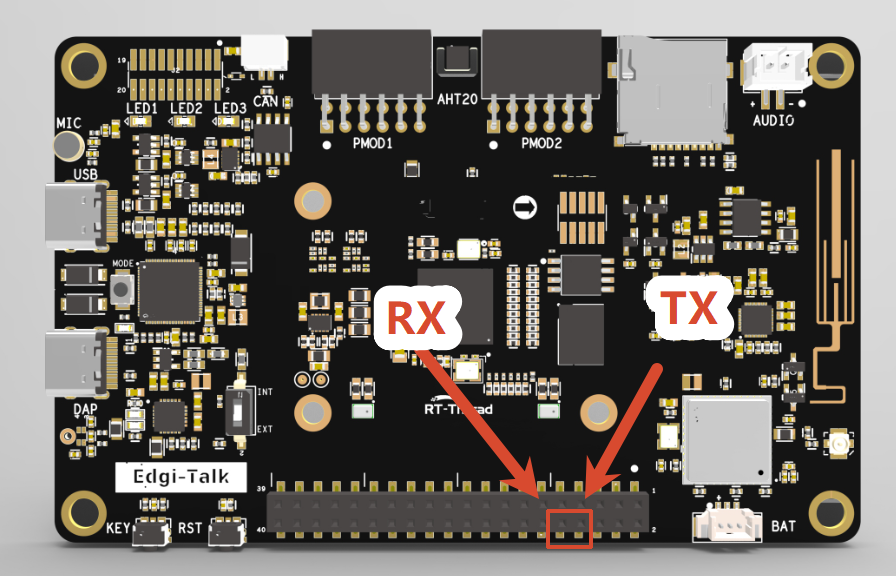

# edgi_talk_coursework

Coursework repository based on the `Edgi_Talk_M33_Template` RT-Thread project
(Edgi-Talk platform, Infineon PSoC Edge E84, Cortex-M33 + Cortex-M55).

[**中文**](./README_zh.md) | **English**

> **Start here:** [`BUILD.md`](./BUILD.md) — how to build the project, how to get
> serial logs, and how each member plugs their module in. (Written in Chinese.)
>
> This is no longer a bare template. `applications/m33/` contains the shared audio
> capture layer, the mode switch, and stub implementations of all four modules,
> so the project compiles and runs end-to-end before anyone writes real logic.
>
> **Two directories are intentionally not in the repo:** `libraries/` and `tools/`
> (265 MB + 162 MB of vendor SDK). See [`BUILD.md` §1.1](./BUILD.md) — you must
> restore them or the build fails. `libraries/HAL_Drivers/` **is** tracked, because
> its `drv_pdm.c` registers the `mic0` device the project depends on.

## Introduction

This template project is based on the **Edgi-Talk platform** and runs a minimal **RT-Thread** application on the Cortex-M33 core.
It is intended to initialize the board, boot the Cortex-M55 core, and then stay idle with all optional peripheral demos disabled.

The shared Secure M33 firmware package lives under `libraries/components/infineon-pse84-secure-firmware-latest`, while keeping the Template `.config` minimal.

## Software Description

* The project is developed based on the **Edgi-Talk** platform.
* `SOC_Enable_CM55` is enabled so board initialization starts the M55 core.
* AHT20, LSM6DS3, audio, ADC, RTC, SD card, filesystem, LCD, Wi-Fi, and other optional peripheral demos are disabled.
* External Wi-Fi/audio power control pins are driven low during board initialization.

## Usage Instructions

### Compilation and Download

1. Open the project and complete the compilation.
2. Connect the board’s USB port to the PC using the **onboard debugger (DAP)**.
3. Use the programming tool to flash the generated firmware to the development board.

### Runtime Behavior

* After flashing, power on the board to run the example project.
* M33 initializes RT-Thread, starts M55, prints a short boot message, and then stays idle.
* The template does not blink LEDs or start peripheral demos automatically.

## Notes

> **⚠️ Note:** This project requires **RT-Thread Studio 2.2.9** or higher.

* The M33 project serial log is not output through the onboard DAP virtual COM port directly. To view `msh />` and demo logs, connect an external USB-to-UART adapter, such as CH340.
The connection position is shown below. Connect the board RX to the UART adapter TX, connect the board TX to the UART adapter RX, and set the host serial baud rate to 115200:



* To modify the **graphical configuration** of the project, open the configuration file using the following tool:

```
tools/device-configurator/device-configurator.exe
libs/TARGET_APP_KIT_PSE84_EVAL_EPC2/config/design.modus
```

* After modification, save the configuration and regenerate the code.
* To run an M55 project, it is recommended to flash **Edgi_Talk_M33_Template** first. It is a clean M33 project and is suitable as the base firmware before starting M55.

## Boot Sequence

The system boot sequence is as follows:

```
+------------------+
|   Secure M33     |
|   (Secure Core)  |
+------------------+
          |
          v
+------------------+
|       M33        |
| (Non-Secure Core)|
+------------------+
          |
          v
+-------------------+
|       M55         |
| (Application Core)|
+-------------------+
```

⚠️ Please strictly follow the boot sequence above when flashing firmware; otherwise, the system may not run properly.

---

* If the example project does not run correctly, compile and flash the **Edgi_Talk_M33_Template** project first to ensure proper initialization and core startup before running this example.
* To enable the M55 core, configure the **M33 project** as follows:

  ```
  RT-Thread Settings --> Hardware --> select SOC Multi Core Mode --> Enable CM55 Core
  ```
